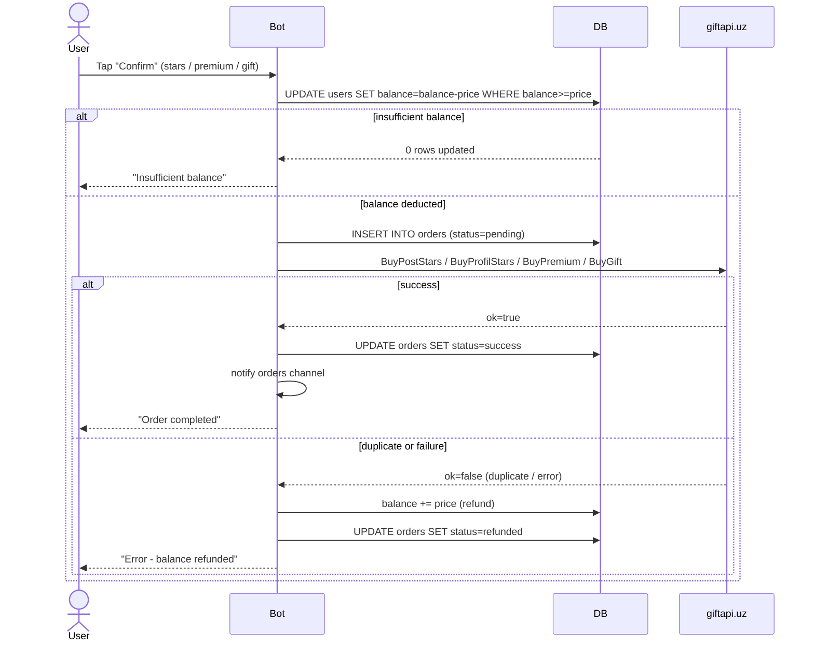
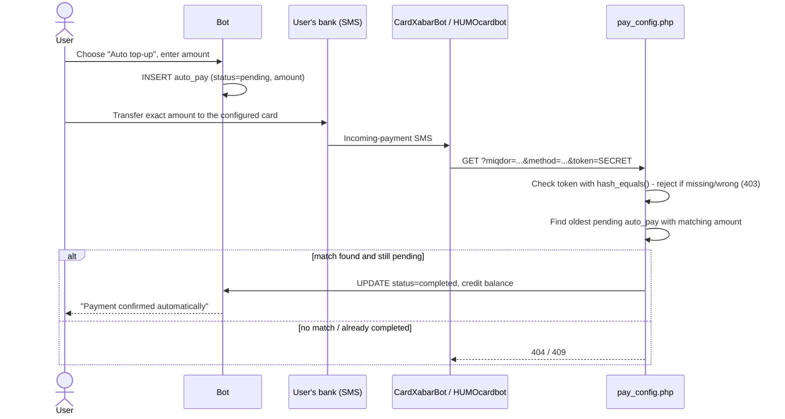
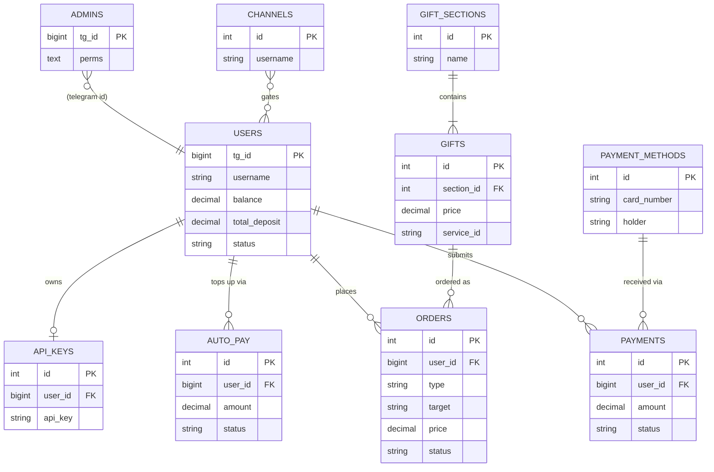

# Telegram Stars / Premium / Gift Reseller Bot

A Telegram bot storefront that resells **Telegram Stars** (boost a post or a
profile), **Telegram Premium** (3/6/12-month plans) and **Telegram Gifts**,
fulfilled through the third-party aggregator **giftapi.uz**. Customers pay
into an in-bot wallet (manual card transfer + admin approval, or an
automatic "AvtoPay" bank-SMS-forwarding flow), then spend that balance on
orders. The bot also exposes a small partner/reseller API so a customer can
resell these same services from their own bot or site.

> Read this in Uzbek: [README.uz.md](README.uz.md)

## ⚠️ Security fixes in this cleanup

This codebase was reviewed before publishing, and **three serious issues**
were found and fixed. If you obtained an earlier copy of this bot from
elsewhere, you should assume it has these problems and treat this list as a
checklist.

| # | Issue | Risk | Fix |
|---|-------|------|-----|
| 1 | **Hidden backdoor owner.** `core/db.php` had a `db_client_signature()` function, disguised with a misleading "diagnostics" comment, that `base64_decode`'d a fixed Telegram ID (`670059053`) and granted it full, permanent, **invisible** bot-owner rights — independent of `ADMIN_ID` and never listed in the admin panel. | Critical — whoever controls that Telegram account could silently drain balances, redirect payment card numbers, rotate the giftapi.uz API key, and more. | The function and its usage were deleted entirely. `is_owner()` now checks only the `ADMIN_ID` you configure. |
| 2 | **Admin permission bypass.** Per-admin permissions (stats-only, payments-only, etc.) were enforced only for the reply-keyboard menu. Every inline-button action (balance edits, admin management, API key, maintenance mode...) only checked "is this person *any* admin", not "is this person allowed to do *this*". A limited admin could grant themselves full rights by sending the right `callback_data`. | High — privilege escalation by any admin, however limited their intended access. | Added `admin_action_perm()` in `index.php`: every inline admin action is now re-checked against the same permission system as the menu buttons. |
| 3 | **Unauthenticated AvtoPay webhook.** `AvtoPay/pay_config.php` accepted `?miqdor=...&method=...` from anyone, with no secret, no signature. Any customer could create a "pending" auto top-up for an amount of their choosing and then call the URL themselves to mark it paid — crediting their wallet without transferring any real money. | Critical — direct, unlimited financial loss funded by your real giftapi.uz balance. | Added a required `AVTOPAY_TOKEN` (set in `config.php`, and appended as `&token=...` to the webhook URL you give CardXabarBot / HUMOcardbot / @LockAvtoPayBot). The endpoint now **fails closed**: with no token configured, it refuses every request. |

All three are covered by the automated test suite (see [Testing](#testing)).
If you already ran an earlier version of this bot in production, rotate
your giftapi.uz API key and review your `orders`/`payments`/`admins` tables
for anything you don't recognize.

## Features

- ⭐️ Stars for a post or a profile, 🌟 Telegram Premium (3/6/12 months), 🎁 a
  configurable gift catalog grouped into sections.
- 💰 Wallet balance, funded by manual card transfer (photo/PDF receipt →
  admin approval) or by AvtoPay (see diagram below).
- 🧑‍💻 Admin panel with per-admin granular permissions (stats, prices,
  payments, gifts, users, channels, API, ads, extra settings, guides,
  admins, bot status).
- 📣 Mandatory-channel-subscription gate, broadcast/ads to all users,
  maintenance mode, user blocking.
- 🔑 A small partner API (`/api/`) so your own customers can place orders
  programmatically against their own sub-balance — see `/api/docs.php`.
- Atomic order handling: balance is pre-deducted before calling giftapi.uz
  and automatically refunded on failure or a detected duplicate request.

## How an order is fulfilled



## How AvtoPay works (and where the new token check sits)

AvtoPay is an informal, widely-used pattern in Uzbek/Russian Telegram
commerce: a small helper bot on the seller's phone reads incoming bank SMS
and forwards "payment received" events to a webhook. It is **not** an
official bank integration — treat it as a convenience on top of manual
verification, not a substitute for watching your real bank statement.



## Data model



`schema.sql` is an empirically-dumped snapshot of this structure (14
tables) for reference — you do not need to run it by hand, see Setup below.

## Requirements

- PHP 7.4+ (8.0+ recommended; a few PHP-8 functions are polyfilled for 7.4)
- MySQL or MariaDB
- PHP extensions: `pdo_mysql`, `curl` (`mbstring` recommended, polyfilled if missing)
- A domain with HTTPS (required by Telegram for webhooks)
- A giftapi.uz shop API key (for fulfillment)
- Optional: CardXabarBot / HUMOcardbot / @LockAvtoPayBot, only if you want AvtoPay

## Setup

1. **Configure.** Copy `config.example.php` to `config.php` and fill in
   `BOT_TOKEN` (from @BotFather), `ADMIN_ID` (your Telegram ID, from
   @userinfobot), your MySQL credentials, a random `WEBHOOK_SECRET`, and —
   if you plan to use AvtoPay — a random `AVTOPAY_TOKEN`
   (`php -r "echo bin2hex(random_bytes(16));"` is a quick way to generate
   either secret). **`config.php` holds real secrets — never commit it**;
   `.gitignore` already excludes it.
2. **Install the database.** Open `https://yourdomain.uz/index.php` in a
   browser once. It auto-creates all 14 tables, seeds default settings, and
   registers `ADMIN_ID` as the owner admin. The page reports any problem
   (missing token, DB connection, missing `curl`) in plain language.
3. **Set the Telegram webhook**, including the secret token:
   ```
   https://api.telegram.org/bot<BOT_TOKEN>/setWebhook?url=https://yourdomain.uz/index.php&secret_token=<WEBHOOK_SECRET>
   ```
4. **Configure giftapi.uz.** In the bot's admin panel → "🔑 Api sozlamalasi",
   paste your giftapi.uz shop API key.
5. **Configure prices, gifts and payment methods** from the admin panel
   (📊/💰/🛍/💳 sections) — none of this is hardcoded.
6. **(Optional) Enable AvtoPay.** In "💳 To'lov tizimlari → ⚡️ Avto pay
   sozlama", set the receiving card and turn it on. Then, in
   CardXabarBot / HUMOcardbot / @LockAvtoPayBot's own settings, set their
   webhook to:
   ```
   https://yourdomain.uz/AvtoPay/pay_config.php?token=<AVTOPAY_TOKEN>
   ```
   (they append `&miqdor=...&method=...` themselves). Without a configured
   `AVTOPAY_TOKEN`, this endpoint refuses every request — AvtoPay simply
   won't work until you set one, by design.
7. **Set up the broadcast cron** (only needed when you send ads):
   ```
   * * * * * php /path/to/send.php
   ```

## Admin permissions

Each admin (added from "🧑‍💻 Admin sozlamalari", owner-only) can be granted
any subset of: `stats`, `prices`, `pay`, `gifts`, `users`, `channels`,
`api`, `ads`, `extra`, `guides`, `admins`, `status`. The owner (`ADMIN_ID`)
always has every permission and is the only one who can add new admins or
change another admin's permission set.

## Testing

```
php tests/run.php
```

Runs 34 automated checks against a disposable MySQL/MariaDB database you
point `tests/config.test.php` at — it never contacts the real Telegram API
or giftapi.uz (both are replaced with in-process test doubles). It covers:
the backdoor's removal, the full admin-permission matrix (including that a
limited admin cannot escalate their own rights), order atomicity (balance
deduction, success, duplicate-refund, failure-refund), the double-tap /
stale-confirmation fix, and the blocked-user state-machine fix. The
AvtoPay token check, the webhook secret check, and the partner API were
additionally verified end-to-end over real HTTP against a temporary
`php -S` server during development.

## Project structure

```
index.php              Telegram webhook entry point + routing
send.php               Broadcast/ads sender (run via cron)
config.example.php     Copy to config.php and fill in your own values
schema.sql             Reference dump of the auto-installed schema
core/db.php             Database layer, settings, users, admin permissions
core/tg.php             Telegram Bot API client + keyboards
core/service.php        giftapi.uz client, pricing, subscription gate, orders
handlers/user.php       Customer-facing flows
handlers/admin.php      Admin panel flows
api/index.php           Partner/reseller API
api/docs.php            Partner API documentation page
AvtoPay/pay_config.php  AvtoPay webhook (token-protected)
tests/run.php           Automated test suite
```

## What changed from the original

- Removed the hidden backdoor owner ID entirely (see Security table above).
- Closed the admin-permission bypass on inline buttons.
- Added mandatory AvtoPay token authentication (fail-closed).
- Fixed a double-tap race on order confirmation (stale state is now
  detected and rejected instead of producing a zero-value order attempt).
- A blocked/maintenance-gated/unsubscribed user can no longer continue an
  in-progress order through to the confirmation step; they're stopped as
  soon as they send their next message, same as everywhere else in the bot.
- Added `config.example.php` + `.gitignore` so real secrets never need to
  be committed (the original shipped one `config.php` meant to be edited
  in place).
- Added the automated test suite, the diagrams above, and this README
  (replacing the original plain-text `README.txt`, whose setup steps are
  now covered here in more detail, in two languages).
  No customer-facing feature was removed.
