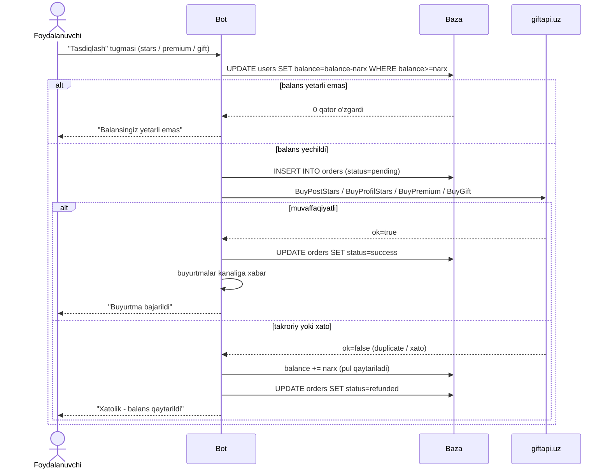
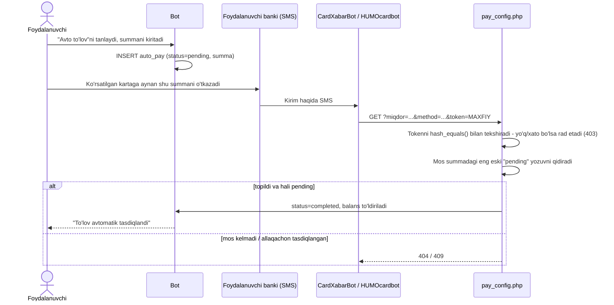
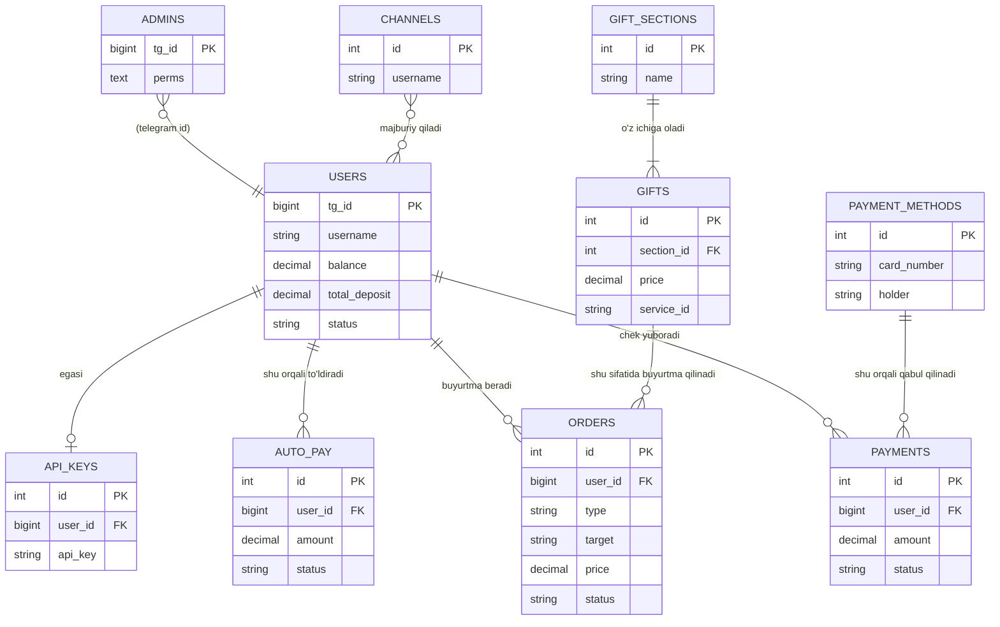

# Telegram Stars / Premium / Gift Sotuvchi Bot

Telegram **Stars** (post yoki profilga), **Telegram Premium** (3/6/12 oylik)
va **Telegram Gift**larni sotadigan do'kon-bot. Xizmatlar uchinchi tomon
agregatori **giftapi.uz** orqali bajariladi. Mijozlar bot ichidagi hamyonga
pul to'ldiradi (karta orqali qo'lda — chek rasmi + admin tasdig'i, yoki
"AvtoPay" — bank SMS'ini avtomatik aniqlash orqali), so'ng shu balansdan
xarid qiladi. Botda mijozlaringiz o'z boti/sayti orqali shu xizmatlarni
dasturiy ravishda sota oladigan kichik hamkorlar API'si ham bor.

> Ingliz tilida o'qish: [README.md](README.md)

## ⚠️ Ushbu tozalashda tuzatilgan xavfsizlik muammolari

Kod GitHub'ga joylashtirishdan oldin ko'rib chiqildi va **3 ta jiddiy
muammo** topilib tuzatildi. Agar botning avvalgi nusxasini boshqa joydan
olgan bo'lsangiz, unda ham xuddi shu muammolar borligini hisobga oling.

| # | Muammo | Xavf | Tuzatish |
|---|--------|------|----------|
| 1 | **Yashirin backdoor (orqa eshik) egasi.** `core/db.php`da `db_client_signature()` funksiyasi bor edi — soxta "diagnostika" izohi bilan yashiringan, `base64_decode` orqali qattiq yozilgan Telegram ID'ni (`670059053`) qaytarar va unga to'liq, doimiy, **ko'rinmas** bot-egasi huquqini berar edi — `ADMIN_ID`ga bog'liq bo'lmagan va admin panelida hech qachon ko'rinmaydigan holda. | Juda jiddiy — shu Telegram hisobini nazorat qiluvchi kimdir balanslarni yashirincha bo'shatishi, to'lov karta raqamlarini almashtirishi, giftapi.uz API kalitini yangilashi va h.k. mumkin edi. | Funksiya va uning barcha ishlatilishi butunlay o'chirildi. `is_owner()` endi faqat siz sozlagan `ADMIN_ID`ni tekshiradi. |
| 2 | **Admin ruxsatlarini chetlab o'tish.** Har bir adminga alohida ruxsat (faqat statistika, faqat to'lovlar va h.k.) faqat asosiy menyu tugmalarida tekshirilar edi. Xabar ichidagi har qanday inline tugma amali (balans o'zgartirish, admin boshqaruvi, API kalit, ta'mirlash rejimi...) faqat "bu odam umuman adminmi" tekshirilar, "aniq shu amalga ruxsati bormi" tekshirilmas edi. Cheklangan huquqli admin to'g'ri `callback_data` yuborib, o'ziga to'liq huquq bera olardi. | Yuqori — har qanday (hatto juda cheklangan) admin o'z huquqini oshirib olishi mumkin edi. | `index.php`ga `admin_action_perm()` qo'shildi: endi har bir inline admin amali xuddi menyu tugmalaridagi kabi ruxsat tizimi orqali qayta tekshiriladi. |
| 3 | **AvtoPay webhook'da autentifikatsiya yo'qligi.** `AvtoPay/pay_config.php` hech qanday maxfiy tokensiz, hech kimdan `?miqdor=...&method=...` so'rovini qabul qilar edi. Har qanday mijoz o'zi xohlagan summaga "pending" yozuv yaratib, keyin shu manzilni o'zi ochib, haqiqiy pul to'lamasdan "to'landi" deb belgilab qo'ya olardi. | Juda jiddiy — to'g'ridan-to'g'ri, cheksiz moliyaviy yo'qotish (haqiqiy giftapi.uz hamyoningiz hisobidan). | Majburiy `AVTOPAY_TOKEN` qo'shildi (`config.php`da sozlanadi, webhook manziliga `&token=...` sifatida qo'shiladi). Endi token sozlanmagan bo'lsa, bu manzil **barcha** so'rovlarni rad etadi (fail-closed). |

Uchalasi ham avtomatik test to'plamida tekshiriladi (qarang: [Testlash](#testlash)).
Agar botning avvalgi versiyasini productionda ishlatgan bo'lsangiz,
giftapi.uz API kalitingizni almashtiring va `orders`/`payments`/`admins`
jadvallarini notanish yozuvlarga tekshiring.

## Imkoniyatlar

- ⭐️ Postga yoki profilga Stars, 🌟 Telegram Premium (3/6/12 oy), 🎁 bo'limlarga
  guruhlangan sozlanadigan gift katalogi.
- 💰 Hamyon balansi — qo'lda karta orqali (chek rasmi/PDF → admin tasdig'i)
  yoki AvtoPay orqali to'ldiriladi (pastdagi diagrammaga qarang).
- 🧑‍💻 Har bir admin uchun alohida ruxsatlar bilan admin panel (statistika,
  narxlar, to'lovlar, giftlar, userlar, kanallar, API, reklama, qo'shimcha
  sozlamalar, qo'llanma, adminlar, bot holati).
- 📣 Majburiy kanal obunasi, barcha foydalanuvchilarga reklama yuborish,
  ta'mirlash rejimi, foydalanuvchini bloklash.
- 🔑 Kichik hamkorlar API'si (`/api/`) — mijozlaringiz o'z sub-balansidan
  dasturiy ravishda buyurtma bera oladi, qarang: `/api/docs.php`.
- Atomik buyurtma bajarish: balans giftapi.uz'ga so'rov yuborishdan OLDIN
  yechiladi va xatolik yoki takroriy so'rov aniqlanganda avtomatik qaytariladi.

## Buyurtma qanday bajariladi



## AvtoPay qanday ishlaydi (va yangi token tekshiruvi qayerda)

AvtoPay — O'zbek/Rus Telegram-tijorati doirasida keng tarqalgan norasmiy
usul: sotuvchining telefonidagi yordamchi bot kiruvchi bank SMS'larini
o'qib, "to'lov keldi" hodisasini webhook'ga yuboradi. Bu **rasmiy bank
integratsiyasi emas** — uni qo'lda tekshirish ustiga qo'yilgan qulaylik
sifatida qarang, haqiqiy bank hisobotingizni kuzatish o'rnini bosmaydi.



## Ma'lumotlar modeli



`schema.sql` — shu tuzilmaning (14 jadval) haqiqiy sandboxdan olingan
nusxasi, faqat ma'lumot uchun — uni qo'lda ishga tushirish shart emas,
pastdagi O'rnatish bo'limiga qarang.

## Talablar

- PHP 7.4+ (8.0+ tavsiya etiladi; bir nechta PHP-8 funksiyalari 7.4 uchun
  moslashtirilgan)
- MySQL yoki MariaDB
- PHP kengaytmalari: `pdo_mysql`, `curl` (`mbstring` tavsiya etiladi, yo'q
  bo'lsa ham ishlayveradi)
- HTTPS'li domen (Telegram webhook uchun talab qiladi)
- giftapi.uz do'kon API kaliti (xizmatlarni bajarish uchun)
- Ixtiyoriy: CardXabarBot / HUMOcardbot / @LockAvtoPayBot — faqat AvtoPay
  kerak bo'lsa

## O'rnatish

1. **Sozlang.** `config.example.php`ni `config.php`ga nusxalang va
   `BOT_TOKEN` (@BotFather'dan), `ADMIN_ID` (@userinfobot orqali bilib
   olingan Telegram ID'ingiz), MySQL ma'lumotlari, tasodifiy
   `WEBHOOK_SECRET`, va — AvtoPay ishlatmoqchi bo'lsangiz — tasodifiy
   `AVTOPAY_TOKEN` kiriting (`php -r "echo bin2hex(random_bytes(16));"`
   buyrug'i tez tasodifiy qiymat beradi). **`config.php` haqiqiy
   sirlaringizni saqlaydi — uni hech qachon git'ga qo'shmang**;
   `.gitignore` buni allaqachon chiqarib tashlagan.
2. **Bazani o'rnating.** Brauzerda bir marta `https://domeningiz.uz/index.php`
   manzilini oching. Barcha 14 jadval avtomatik yaratiladi, standart
   sozlamalar yoziladi va `ADMIN_ID` egasi (owner) admin sifatida
   ro'yxatga olinadi. Sahifa har qanday muammoni (bo'sh token, baza
   ulanishi, `curl` yo'qligi) tushunarli tilda ko'rsatadi.
3. **Telegram webhook'ni sozlang**, maxfiy token bilan birga:
   ```
   https://api.telegram.org/bot<BOT_TOKEN>/setWebhook?url=https://domeningiz.uz/index.php&secret_token=<WEBHOOK_SECRET>
   ```
4. **giftapi.uz'ni sozlang.** Admin panelda "🔑 Api sozlamalasi"ga o'ting
   va giftapi.uz do'kon API kalitingizni kiriting.
5. **Narxlar, giftlar va to'lov usullarini sozlang** — admin paneldan
   (📊/💰/🛍/💳 bo'limlari), hech narsa kodda qattiq yozilmagan.
6. **(Ixtiyoriy) AvtoPay'ni yoqing.** "💳 To'lov tizimlari → ⚡️ Avto pay
   sozlama"da qabul qiluvchi kartani kiriting va yoqing. Keyin
   CardXabarBot / HUMOcardbot / @LockAvtoPayBot'ning o'z sozlamalarida
   webhook manzilini shunga o'rnating:
   ```
   https://domeningiz.uz/AvtoPay/pay_config.php?token=<AVTOPAY_TOKEN>
   ```
   (ular o'zlari `&miqdor=...&method=...` qo'shib yuboradi). `AVTOPAY_TOKEN`
   sozlanmagan bo'lsa, bu manzil barcha so'rovlarni rad etadi — AvtoPay
   shunchaki ishlamaydi, bu qasddan shunday qilingan.
7. **Reklama uchun cron sozlang** (faqat reklama yuborganda kerak):
   ```
   * * * * * php /yoldagi/send.php
   ```

## Admin ruxsatlari

Har bir admin ("🧑‍💻 Admin sozlamalari"dan qo'shiladi, faqat owner qo'sha
oladi) quyidagilarning istalgan to'plamiga ega bo'lishi mumkin: `stats`,
`prices`, `pay`, `gifts`, `users`, `channels`, `api`, `ads`, `extra`,
`guides`, `admins`, `status`. Egasi (`ADMIN_ID`) doim barcha huquqqa ega va
faqat u yangi admin qo'sha oladi yoki boshqa adminning ruxsatlarini
o'zgartira oladi.

## Testlash

```
php tests/run.php
```

`tests/config.test.php` ko'rsatgan vaqtinchalik MySQL/MariaDB bazasida 34
ta avtomatik tekshiruvni bajaradi — haqiqiy Telegram API'siga yoki
giftapi.uz'ga hech qachon murojaat qilmaydi (ikkalasi ham test-rejim bilan
almashtirilgan). Tekshiriladigan narsalar: backdoor olib tashlanganligi,
to'liq admin-ruxsat matritsasi (shu jumladan cheklangan admin o'z huquqini
oshira olmasligi), buyurtma atomikligi (balans yechish, muvaffaqiyat,
takroriy-qaytarish, xato-qaytarish), ikki marta bosish/eskirgan holat
tuzatishi va bloklangan foydalanuvchi holat-mashinasi tuzatishi. AvtoPay
token tekshiruvi, webhook sekreti va hamkorlar API'si qo'shimcha ravishda
haqiqiy HTTP orqali (vaqtinchalik `php -S` serveri bilan) alohida
tekshirildi.

## Loyiha tuzilishi

```
index.php              Telegram webhook kirish nuqtasi + marshrutlash
send.php               Reklama yuboruvchi (cron orqali ishga tushadi)
config.example.php     config.php qilib nusxalang va o'z qiymatlaringizni kiriting
schema.sql             Avtomatik o'rnatiladigan sxemaning namunasi
core/db.php             Baza qatlami, sozlamalar, userlar, admin ruxsatlari
core/tg.php             Telegram Bot API mijozi + klaviaturalar
core/service.php        giftapi.uz mijozi, narxlash, obuna tekshiruvi, buyurtmalar
handlers/user.php       Foydalanuvchi oqimlari
handlers/admin.php      Admin panel oqimlari
api/index.php           Hamkorlar (reseller) API'si
api/docs.php            Hamkorlar API hujjatlari sahifasi
AvtoPay/pay_config.php  AvtoPay webhook (token bilan himoyalangan)
tests/run.php           Avtomatik test to'plami
```

## Original nusxadan nima o'zgardi

- Yashirin backdoor egasi ID'si butunlay olib tashlandi (yuqoridagi
  Xavfsizlik jadvaliga qarang).
- Inline tugmalardagi admin-ruxsat chetlab o'tish imkoniyati yopildi.
- Majburiy AvtoPay token autentifikatsiyasi qo'shildi (fail-closed).
- Buyurtmani tasdiqlashda ikki marta bosish poyga holati tuzatildi
  (eskirgan holat endi aniqlanadi va rad etiladi, nol qiymatli buyurtma
  urinishi o'rniga).
- Bloklangan/ta'mirlash-rejimidagi/obuna bo'lmagan foydalanuvchi endi
  davom etayotgan buyurtmani tasdiqlash bosqichigacha olib bora olmaydi —
  botning boshqa joylaridagi kabi, keyingi xabarini yuborishi bilanoq
  to'xtatiladi.
- `config.example.php` + `.gitignore` qo'shildi, shunda haqiqiy sirlar
  hech qachon git'ga tushmaydi (original bitta `config.php` faylini joyida
  tahrirlashga mo'ljallangan edi).
- Avtomatik test to'plami, yuqoridagi diagrammalar va ushbu README
  qo'shildi (original oddiy matnli `README.txt` o'rniga — uning barcha
  o'rnatish qadamlari endi shu yerda, batafsilroq va ikki tilda bor).
  Hech qanday mijozga ko'rinadigan funksiya olib tashlanmadi.
